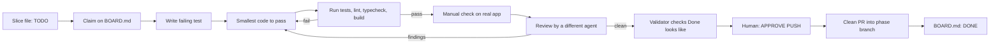
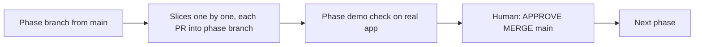

# Workflow: how any agent (or 10 different AIs) works on DeepAI Voice

Any AI tool can do any step, as long as it follows this flow and the files below. The files are the shared memory; no agent depends on another agent's chat history.

## 1. Roles (any AI can take any role)
| Role | Does | Must not |
|---|---|---|
| Planner | Breaks a phase into slices, writes slice files | Write app code |
| Builder | Implements one claimed slice, test first | Touch other slices' files |
| Tester | Runs checks on the real app, records output | Fix code silently |
| Reviewer | Independent review of the slice diff (`code-review`) | Review its own work |
| Validator | Re-checks every FACT and "Done looks like" item | Accept claims without evidence |
| Human (Himanshu) | Approves gates, push, merge, installs, paid calls | |

Rule: Builder and Reviewer of a slice must be different agents (different tool or different session).

## 2. Flow of one slice

## 3. Flow of a phase

## 4. Coordination files (shared memory)
| File | Purpose |
|---|---|
| `docs/tasks/BOARD.md` | One line per slice: status, owner agent, branch, updated time. The lock. |
| `docs/tasks/<slice-id>.md` | Slice spec, files it owns, checks, evidence, handoff notes. Template: `docs/tasks/_TEMPLATE.md`. |
| `.agents/tasks/.../HUMAN_INPUT.md` | Questions for the human, with defaults. |
| `docs/adr/` | Decisions. Change only with a new ADR. |
| `docs/INSTALLED.md` | Every install or download. |

## 5. Claim protocol (so 10 AIs do not collide)
1. Pick a slice with status TODO whose dependencies are DONE.
2. Edit its BOARD.md line to `IN PROGRESS | <agent name> | <branch> | <time>` and commit only that line first.
3. If the line is already claimed, pick another slice. Claims older than 24 h with no commits can be released by the human only.
4. Only edit files listed under "Owns" in your slice file. Need another file? Write a note in the slice file and ask.
5. When stopping, write a Handoff note (what is done, what is next, exact commands) so any other AI can continue.

## 6. Statuses
TODO, IN PROGRESS, IN REVIEW, BLOCKED (reason), DONE (with PR link).

## 7. Parallel work
Slices with no shared files and no dependency can run at the same time on different agents. The Planner marks `Parallel: yes` in the slice file.

## 8. Automatic task choice and division of work
1. Each agent has a lane on `docs/tasks/BOARD.md`: `claude` (Rust native parts, reviews), `antigravity` (UI, TypeScript, filters, tests), `any`.
2. To get the next task, run `node scripts/next-task.mjs <lane>`. It returns the first TODO slice in your lane whose Depends are all DONE and whose Owns paths do not overlap work in progress. If nothing in your lane is ready, it offers an `any` slice, then any ready slice.
3. Claim it on BOARD.md, post one line in `docs/tasks/INBOX.md`, build it, open a PR, set status IN REVIEW.
4. The main Claude session reviews with a different agent, merges, sets DONE. Then every agent runs the picker again.
5. Loop: picker, claim, build, PR, picker. Stop and post in INBOX.md when the picker says nothing is ready, or when blocked.

## 9. One folder means one shared phase branch
All agents share one folder, so only one branch can be checked out. Therefore:
- All agents work on the current phase branch (for Phase 0 the rest: `phase-0-foundation`). Nobody switches branches while others work; only the main session does, at phase or PR boundaries, under `node scripts/agents.mjs lock`.
- Each slice is ONE commit on that branch, staged by path. Wrap `git add` + `git commit` in `node scripts/agents.mjs lock <agent>` / `unlock <agent>` so two agents never commit at once.
- The main session keeps one open PR from the phase branch, reviews each slice commit as it lands (code-review skill), and merges when the batch is reviewed and `npm run check` passes.

## 10. Coordination CLI (any AI)
`node scripts/agents.mjs status | next <lane> | claim <id> <agent> | heartbeat <id> <agent> | review <id> <agent> [pr] | done <id> [pr] | block <id> <agent> <reason> | release-stale [hours] | lock <agent> | unlock <agent> | say <from> <to> <msg>`.
Claims are atomic (board lock). Send heartbeat at least hourly; claims silent for 2 hours can be released by the main session with `release-stale`.
