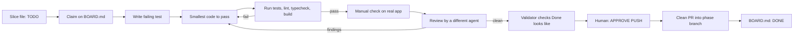
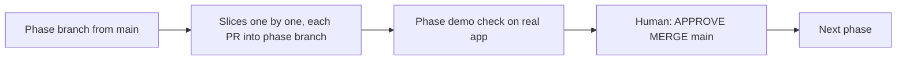

# Workflow: how any agent (or 10 different AIs) works on DeepAI Voice

Any AI tool can do any step, as long as it follows this flow and the files below. The files are the shared memory; no agent depends on another agent's chat history.

## 1. Roles (any AI can take any role)
| Role | Does | Must not |
|---|---|---|
| Planner | Breaks a phase into slices, writes slice files | Write app code |
| Builder | Implements one claimed slice, test first | Touch other slices' files |
| Tester | Runs checks on the real app, records output | Fix code silently |
| Reviewer | Independent review of the slice diff (`code-review`) | Review its own work |
| Validator | Re-checks every FACT and "Done looks like" item | Accept claims without evidence |
| Human (Himanshu) | Approves gates, push, merge, installs, paid calls | |

Rule: Builder and Reviewer of a slice must be different agents (different tool or different session).

## 2. Flow of one slice

## 3. Flow of a phase

## 4. Coordination files (shared memory)
| File | Purpose |
|---|---|
| `docs/tasks/BOARD.md` | One line per slice: status, owner agent, branch, updated time. The lock. |
| `docs/tasks/<slice-id>.md` | Slice spec, files it owns, checks, evidence, handoff notes. Template: `docs/tasks/_TEMPLATE.md`. |
| `.agents/tasks/.../HUMAN_INPUT.md` | Questions for the human, with defaults. |
| `docs/adr/` | Decisions. Change only with a new ADR. |
| `docs/INSTALLED.md` | Every install or download. |

## 5. Claim protocol (so 10 AIs do not collide)
1. Pick a slice with status TODO whose dependencies are DONE.
2. Edit its BOARD.md line to `IN PROGRESS | <agent name> | <branch> | <time>` and commit only that line first.
3. If the line is already claimed, pick another slice. Claims older than 24 h with no commits can be released by the human only.
4. Only edit files listed under "Owns" in your slice file. Need another file? Write a note in the slice file and ask.
5. When stopping, write a Handoff note (what is done, what is next, exact commands) so any other AI can continue.

## 6. Statuses
TODO, IN PROGRESS, IN REVIEW, BLOCKED (reason), DONE (with PR link).

## 7. Parallel work
Slices with no shared files and no dependency can run at the same time on different agents. The Planner marks `Parallel: yes` in the slice file.
